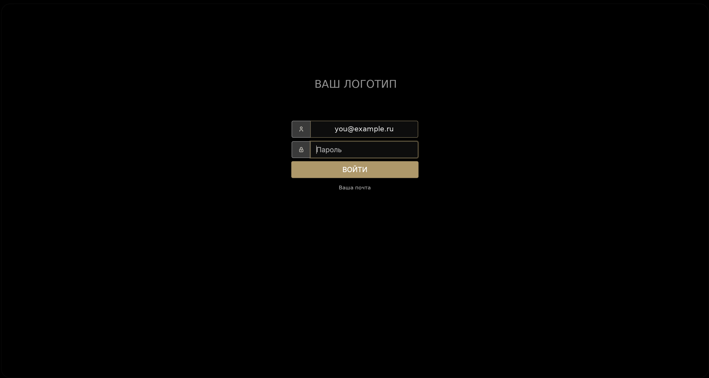
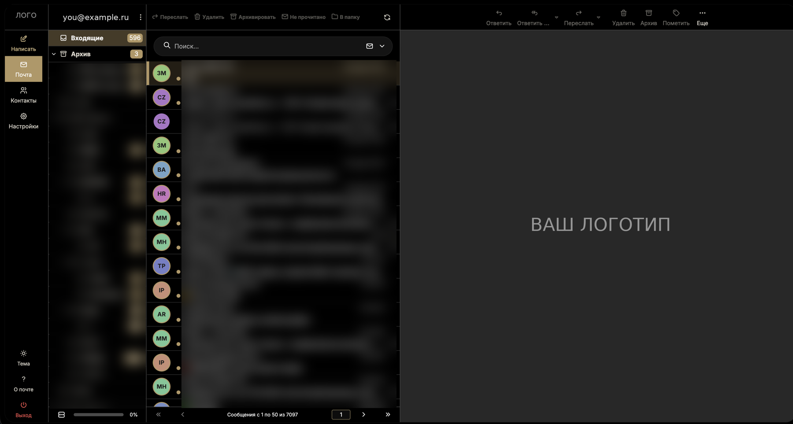

# Свой почтовый сервер на VPS: пошаговая инструкция и переезд с Яндекс.Почты

Как поднять **свой почтовый сервер** (Ubuntu, VPS, Docker или Postfix + Dovecot), настроить SPF, DKIM, DMARC и **перенести все письма с Яндекс.Почты** без потерь. Адреса остаются прежними. Инструкция написана так, чтобы её мог выполнить **Claude Code**: откройте папку, запустите `claude`, и он проведёт вас по шагам.

Основано на реальном переезде: 9 ящиков, около 220 тысяч писем, октябрь 2026.

  

**Содержание:** [Что вы получите](#что-вы-получите) · [Откуда это взялось](#откуда-это-взялось) · [Для кого](#для-кого) · [Установка как навык](#установка-как-навык-claude-code) · [Быстрый старт](#быстрый-старт) · [Что внутри](#что-внутри) · [Вопросы и ответы](#вопросы-и-ответы) · [Помочь проекту](CONTRIBUTING.md)

> **Статус честно:** этот способ работает у нас в боевом режиме (9 ящиков на собственном сервере). Скрипты переноса, досинхронизации и поиска дополнительно проверены в изолированном тесте на чистой Ubuntu 24.04. Готовых конфигов Postfix/Dovecot/DNS в репозитории нет: Claude Code создаёт их под ваш сервер по инструкции и проверяет каждый шаг. Это заготовка и опыт, а не готовый продукт.

## Что вы получите

- Почту на **своём домене и своём сервере**: письма не удалит и не заблокирует чужой сервис.
- **Перенос всей истории** с Яндекса (с вложениями или только текстом, на ваш выбор) и **досинхронизацию**, пока вы не переключили домен.
- **Поиск по всем ящикам сразу** (отправитель, тема, текст, имена вложений).
- **Подсказки адресов** «как у Яндекса» и свой дизайн веб-почты (логотип, цвета, тема).
- Защиту от потерь: повтор без дублей, список писем, которые Яндекс не отдал, защитный хук для ИИ-помощника.
- Проверку доставки на Gmail, Яндекс, Mail.ru: письма не должны попадать в спам.

## Как это выглядит

Веб-почта на Roundcube со своим оформлением: логотип, цвета, тёмная тема, подсказки адресов. Всё меняется под вас (на скриншотах данные и логотип убраны).





## Откуда это взялось

Это сделал не программист, а владелец небольшой компании.

**Проблема.** На Яндекс.Почте у нас стали пропадать письма, причину мы так и не выяснили. Нормально работать с почтой стало нельзя: заявки клиентов, переписка с поставщиками, договорённости — всё это лежало у сервиса, который мы не контролируем и который может ограничить или закрыть доступ.

**Решение, которое я для себя принял.** Почта должна лежать на нашем сервере, под нашим контролем, на нашем домене. Адреса при этом должны остаться прежними, а ни одно письмо не должно потеряться.

**Как это получилось.** Я не писал код сам. Я описывал задачу обычными словами, Claude Code предлагал варианты и смету, а я говорил «да» или «нет». Двигались маленькими шагами и проверяли каждый: сервер, DNS (SPF, DKIM, DMARC), тестовое письмо на Gmail, копирование писем, и только потом переключение. В итоге переехали 9 ящиков, около 220 тысяч писем, с поиском по всем ящикам сразу, подсказками адресов и своим дизайном веб-почты.

**Почему выкладываю.** По дороге мы наступили на много граблей: Яндекс обрывает соединение посреди копирования, часть старых писем не отдаёт вообще, вложения съедают диск в десятки раз, дубли, спам, лишние права. Все они вшиты в инструкцию. Пусть тем, кто хочет уйти с Яндекс.Почты, это обойдётся дешевле и спокойнее.

**Это не готовый продукт, а опыт и заготовка.** У вас получится, и вы здесь создатель: дизайн, цвета, логотип и поведение можно переделать под себя. Пришлите Claude скриншоты почты, которая вам нравится, и он сделает похоже.

- Вы готовы раз в месяц уделить серверу полчаса. Падение сервера = нет почты, это ваша ответственность.

## Для кого

- Вам нужна почта на своём домене и вы не хотите зависеть от Яндекса (в том числе если «Яндекс почта не работает за границей», с VPN или в Outlook).
- Вы готовы раз в месяц уделить серверу полчаса. Падение сервера = нет почты, это ваша ответственность.

## Установка как навык Claude Code

Это готовый **навык (skill)** для Claude Code. Скопируйте папку репозитория в `~/.claude/skills/own-mail-server-yandex-migration/`, запустите `claude` и напишите: «Помоги поднять свой почтовый сервер и перенести почту с Яндекса». Навык подключается по смыслу запроса. Защитный хук (`.claude/hooks/guard.py`) при такой установке сам не включается: его нужно подключить по разделу 0а в `SKILL.md` (Claude сделает это по вашему согласию). В режиме клона репозитория он работает сразу.

## Другие ИИ-помощники (Codex, Gemini CLI, Cursor)

Проект написан для Claude Code, но не привязан к нему. Любой ИИ-помощник, который умеет читать файлы и запускать команды в терминале, может провести вас по `SKILL.md`: в корне лежит `AGENTS.md`, который такие помощники читают сами. Попросите: «Прочитай SKILL.md и проведи меня в режиме интервью». Отличие одно: защитный хук работает только в Claude Code, в остальных помощниках следите за правилами из раздела 0а сами.

## Быстрый старт

```bash
git clone <этот репозиторий> && cd <папка>
claude
# напишите: «Прочитай SKILL.md и проведи меня. Сначала задай вопросы, потом предложи вариант и смету.»
```

## Что внутри

- `AGENTS.md` — указатель для других ИИ-помощников (Codex, Gemini CLI, Cursor).
- `SKILL.md` — навык Claude Code, подробный сценарий: вопросы, 6 вариантов (A–F: Docker-готовые Mailcow/docker-mailserver, ручной Postfix+Dovecot, панель хостинга, Mail-in-a-Box, другой провайдер, гибрид), 7 шагов с проверками, ловушки.
- `scripts/migrate.py` — перенос писем по IMAP с переподключением при обрыве, повтор безопасен (дубли отсекаются по Message-ID или по дате+отправителю+теме), параллельные потоки.
- `scripts/sync.py` и `systemd/` — досинхронизация новых писем каждые 10 минут, пока MX ещё на старом сервере.
- `scripts/search.py` — поиск по всем ящикам сразу (SQLite FTS5): отправитель, получатели, тема, текст, имена вложений.
- `scripts/contacts.py` — подсказки адресов в Roundcube из вашей переписки (как у Яндекса).
- `scripts/mailstrip.py` — по желанию: хранить только текст писем, вложения заменять пометкой (диск 12 ГБ → 0,9 ГБ).
- `.claude/` — защитные хуки Claude Code (не читать пароли, не стирать почту), `tests/test_guard.py` — их проверка.
- `config.example.env` — настройки и пароли (файл `config.env` в git не класть).

## Вопросы и ответы

**Как перенести почту с Яндекса на свой сервер?** Поднять сервер, создать на нём ящики, скопировать письма по IMAP (`scripts/migrate.py` или `imapsync`), потом переключить MX-запись домена. Старую почту не отключать, пока не сверите счётчики.

**Нужен ли «пароль приложения»?** Да. В Яндекс ID включите пароли приложений и доступ по IMAP, обычный пароль при двухфакторной защите не подойдёт.

**Яндекс не отдаёт часть старых писем (`NO [UNAVAILABLE]`).** В нашем опыте так было у 7–35 % старых писем в отдельных ящиках, у вас может быть иначе. Скрипт записывает их в `unavailable.tsv`. Пока такие есть, не отключайте Яндекс.

**Письма с нового сервера попадают в спам.** Проверьте SPF, DKIM, DMARC и PTR (обратную запись IP). У нового IP нулевая репутация: первые 1–2 недели нажимайте «Не спам» и пишите понемногу.

**Какой VPS нужен?** По нашему опыту, для ручной связки Postfix + Dovecot хватало 1–2 ГБ ОЗУ, но это ориентир, не гарантия. Для Mailcow нужно заметно больше (смотрите актуальные требования проекта). Обязателен открытый исходящий порт 25.

## Помочь проекту

Нашли ошибку, у вас получилось или не получилось — откройте Issue (шаблоны подскажут, что написать), правки принимаются через Pull Request: см. [CONTRIBUTING.md](CONTRIBUTING.md). Если проект пригодился, **поставьте звёздочку ⭐**: так его найдут другие. Вопрос по безопасности: [SECURITY.md](SECURITY.md).

## Лицензия

MIT, см. файл `LICENSE`.

---

# English summary

Step-by-step guide and scripts to run **your own mail server on a VPS** and migrate mailboxes from **Yandex Mail** over IMAP (resumable, de-duplicated, with optional attachment stripping). Packaged as a **Claude Code skill** (copy the folder to `~/.claude/skills/own-mail-server-yandex-migration/`) with guard hooks that stop Claude from reading passwords or deleting mail. Based on a real 9-mailbox migration. The scripts were tested in an isolated clean Ubuntu 24.04 environment; mail server configs, DNS/deliverability and real Yandex behaviour have not been re-verified from scratch (see SKILL.md).
